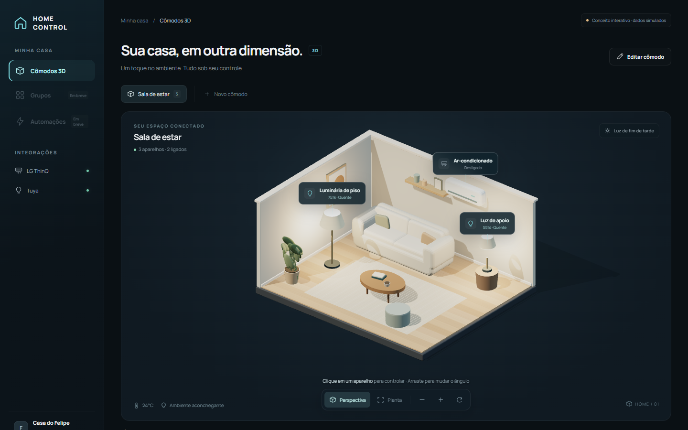
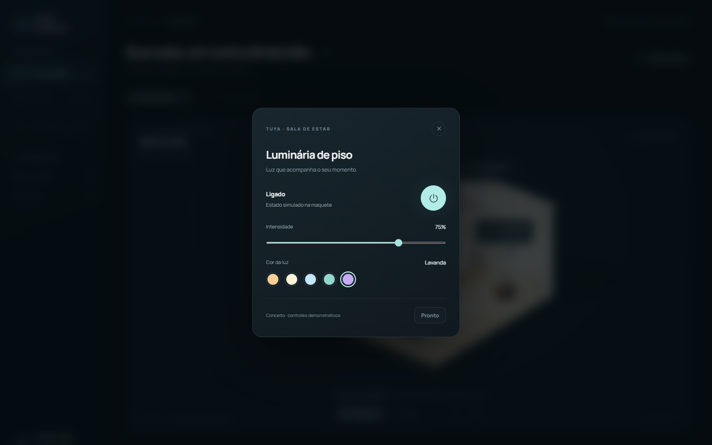

<div align="center">

# 🏠 Home Control

**Central de automação da casa em Electron — o seu ar-condicionado LG e as suas lâmpadas Tuya num só lugar, com uma maquete 3D interativa dos cômodos.**

[](#)
[](#)
[](LICENSE)
[](#stack)



</div>

---

Um aplicativo de desktop que fala com os aparelhos da casa pelas **APIs oficiais** de cada
fabricante — nada de gambiarra ou dependência de serviço de terceiro. Cada integração tem
sua própria tela, e todos os aparelhos convivem numa sala 3D onde você clica numa lâmpada
ou no ar-condicionado e controla de verdade, em tempo real.

## ✨ O que ele faz

- **❄️ Ar-condicionado LG** pela API oficial ThinQ Connect — liga/desliga, temperatura,
  modo e ventilação, mostrando só os controles que o **seu** modelo realmente aceita.
- **💡 Lâmpadas Tuya / Smart Life** pela conexão oficial com Código de Usuário + QR Code —
  liga/desliga, brilho e cor, sem cadastrar projeto cloud nem chave de desenvolvedor.
- **🧊 Cômodos 3D** — uma maquete interativa da sala renderizada com three.js. Os aparelhos
  aparecem no espaço, acendem, mudam de cor e reagem ao estado real; clicar abre os controles.
- **⚡ Estado em tempo real** pelos canais MQTT oficiais da LG e da Tuya (conexão por QR Code):
  mudanças feitas pelo controle remoto ou pelo app do celular aparecem na hora, e a barra
  lateral mostra "Ao vivo". Sem o canal, o app segue atualizando por leitura, como antes.
  Detalhes em [docs/PLANO-TEMPO-REAL.md](docs/PLANO-TEMPO-REAL.md).
- **🔐 Credenciais cifradas** no cofre do sistema operacional (DPAPI no Windows) via
  `safeStorage` — nunca em texto puro, nunca no código.
- **🧩 Arquitetura de drivers** — a interface nunca fala o protocolo de nenhum fabricante;
  somar uma integração nova é implementar um contrato e registrar uma linha.

<div align="center">

</div>

## 🚀 Rodando

```bash
npm install
npm run dev
```

Se o Electron reclamar de `Electron uninstall`, o binário não baixou no `npm install`:

```bash
node node_modules/electron/install.js
```

Outros comandos: `npm test`, `npm run typecheck`, `npm run build`, `npm run dist` (instalador Windows).

## 🧰 Stack

React 19 · TypeScript · Electron · electron-vite · three.js + @react-three/fiber + drei ·
Node `node:test`.

## ❄️ Conectando a conta LG

O ponto que custa a achar: **o portal de token é coreano e o login por ID/senha não
aceita conta de fora da Coreia.** O caminho que funciona é o QR code.

1. Abra <https://connect-pat.lgthinq.com>. A página carrega em coreano — é esperado.
2. Ignore o formulário de ID/senha. Use o **login por QR code** (o link logo abaixo do
   botão) e leia o código com o app ThinQ do celular.
3. `CREATE NEW TOKEN`, marque os escopos, copie o token. A LG mostra ele uma vez só.
4. Cole em Preferências, junto com o país da conta (`BR`).

O token é guardado pelo `safeStorage` do Electron — DPAPI no Windows. Se o cofre do
sistema não estiver disponível, o app recusa salvar em vez de gravar em texto puro.

O perfil usado pelo instalador e pelo `npm run dev` é o mesmo: `%APPDATA%\home-control`.
O arquivo `config.json` fica nesse perfil do usuário, fora do repositório e da pasta do
executável; os tokens permanecem cifrados pelo Windows.

### O que não funciona (para você não refazer a volta)

- `thinq.developer.lge.com` — não existe, não resolve.
- `smartsolution.developer.lge.com` — é a ThinQ **Business** API, outro produto.
- Login por ID/senha no portal de PAT, com conta brasileira.

## 💡 Conectando a Tuya

Selecione **Tuya** na barra lateral e clique em **Conectar Tuya**.

1. No app **Tuya Smart** ou **Smart Life**, abra **Eu → Configurações → Conta e
   segurança → Código de Usuário** e copie o código.
2. Cole no Home Control e clique em **Gerar QR Code**.
3. No app, toque em **＋ → Escanear**, leia o QR Code da tela e confirme a autorização.
   O Home Control reconhece a confirmação e carrega suas lâmpadas automaticamente.

A autorização pode aparecer como **Home Assistant** no app, pois o Home Control usa o
mesmo protocolo público de conexão. O código e o QR substituem o cadastro de projeto
cloud, chaves de desenvolvedor, datacenter, IP e chave local.

Se o QR Code expirar, clique em **Gerar novo QR Code**. Fechar a janela de conexão
cancela a tentativa. Se já autorizou no app, **Já confirmei no celular** verifica na hora.
Depois de conectado, use **Preferências Tuya** para reconectar ou desconectar a conta.
A conexão LG fica separada, com seu token preservado.

> O fluxo requer **Tuya Smart** ou **Smart Life**. Apps de fabricantes, como o Elgin,
> podem não oferecer o Código de Usuário nem aceitar esta autorização. Nesse caso, cadastre
> as lâmpadas em um dos apps compatíveis antes de conectar — elas são Tuya por baixo.

As lâmpadas mostram somente os controles oferecidos pelo aparelho. Se a lista vier vazia,
confira se elas aparecem na conta do app autorizada e reconecte.

Referência: [integração Tuya no Home Assistant](https://www.home-assistant.io/integrations/tuya/).

## 🧱 Arquitetura

```
src/
  shared/types.ts         modelo de aparelho comum a todas as integrações
  main/
    drivers/
      types.ts            a interface Driver
      registry.ts         monta os drivers a partir da configuração
      thinq/client.ts     REST da ThinQ Connect (headers, regiões, erros)
      thinq/driver.ts     perfil e estado do aparelho → modelo comum
      tuya/login.ts       autorização por Código de Usuário e QR Code
      tuya/sharing.ts     transporte e sessão do protocolo público Tuya
      tuya/cloud.ts       suporte a projetos OpenAPI
      tuya/driver.ts      descoberta e comandos das lâmpadas
      tuya/bulb.ts        funções e estado Tuya → capabilities comuns
    store.ts              configuração + credenciais criptografadas no sistema
    ipc.ts                handlers; toda chamada volta como Result<T>
  preload/index.ts        a única superfície que o renderer enxerga
  renderer/
    components/           cards, mostrador de temperatura, preferências
    features/rooms/       a maquete 3D (three.js) e seus aparelhos
```

A UI nunca fala ThinQ nem Tuya. Ela consome `Device` + `Capability[]` e manda `Command`.
Cada aparelho desenha os controles que as capabilities dele declaram — por isso o card do
ar mostra exatamente os modos que o **seu** modelo aceita, lidos do perfil, e não uma lista
chumbada. Para somar um fabricante novo, implemente `Driver` e registre em `registry.ts`;
nem a interface nem o IPC precisam saber que ele existe.

## 🔎 Notas de implementação

Os endpoints, cabeçalhos e o formato dos payloads de controle da LG foram conferidos contra
o SDK oficial `thinqconnect` (Apache-2.0) rodando em modo mock, não deduzidos da
documentação — que é incompleta nessa parte. O formato real:

```json
{ "operation":      { "airConOperationMode": "POWER_ON" } }
{ "airConJobMode":  { "currentJobMode": "COOL" } }
{ "airFlow":        { "windStrength": "HIGH" } }
{ "temperatureInUnits": { "targetTemperature": 23, "unit": "C" } }
```

Detalhe que morde: o alvo de temperatura muda de nome conforme o modo
(`coolTargetTemperature`, `heatTargetTemperature`, `autoTargetTemperature`) e o nome do
recurso varia entre `temperatureInUnits` e `temperature` conforme a geração do aparelho.
O driver lê o perfil e resolve os dois em tempo de execução. Os comandos vão em série e o
perfil fica em cache: a LG limita chamadas por minuto e derruba quem abusa.

## 🗺️ Roadmap

- Grupos de aparelhos e cenas na maquete 3D.
- Automações (gatilhos por horário e por estado).
- Mais fabricantes via novos drivers.

Há um [plano de produto](docs/PLANO-EXPERIENCIA-CASA.md) e uma
[proposta visual do 3D](design/README.md) com mais detalhes.

## 🤝 Contribuindo

Issues e PRs são bem-vindos. Antes de abrir um PR, rode `npm run typecheck && npm test`.
O projeto segue o padrão de que a interface nunca conhece o protocolo de um fabricante —
toda a lógica específica mora num `Driver`.

## ⚖️ Licença e aviso

[MIT](LICENSE). Projeto independente, **sem vínculo com LG, Tuya, Elgin ou Smart Life**.
Os nomes e marcas pertencem aos respectivos donos. Use com os seus próprios aparelhos e as
suas próprias credenciais.
