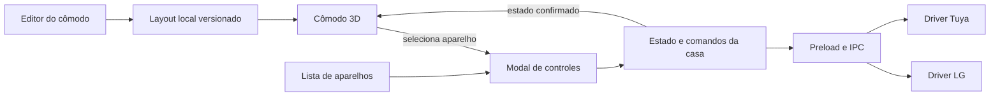

# Experiência da casa: cômodos 3D, grupos e automações

Status: proposta de produto e plano de implementação. Nenhuma destas funcionalidades foi incorporada ao aplicativo nesta etapa.

Prioridade definida em 14/10/2026: **cômodo 3D primeiro**. Direção escolhida: **maquete isométrica elegante, fácil de montar e clicar**.

## O que será entregue primeiro

Uma tela própria de **Cômodos**, com uma maquete interativa que representa os aparelhos já conectados. Clicar em um aparelho abre seus controles em um modal. Entrar no modo de edição permite posicionar aparelhos e móveis sem desenhar uma planta técnica.

O primeiro resultado utilizável deve permitir criar uma sala, colocar as duas lâmpadas Tuya e o ar LG nela, salvar o ambiente e controlar cada aparelho pelo modal. Os cômodos reúnem aparelhos de integrações diferentes; as configurações e telas LG/Tuya continuam independentes.

A proposta visual está em [room-3d-concept.html](../design/room-3d-concept.html). É uma demonstração com dados fictícios: os controles alteram somente a maquete. O 3D do conceito usa Three.js por CDN e precisa de internet para carregar; na implementação do Electron, os recursos serão empacotados localmente.

## Direção visual

- Interface escura em continuidade com o app: fundo grafite, superfícies discretas, tipografia clara e ciano usado para foco e seleção.
- Interior acolhedor: madeira clara, tecidos naturais, móveis de formas suaves, plantas e luz quente. Cor aparece na iluminação do ambiente, sem transformar toda a interface em neon.
- Maquete em destaque, com câmera ortográfica, paredes abertas e ângulo isométrico. A vista inicial deve explicar o ambiente sem exigir que a pessoa aprenda a mover uma câmera.
- Madeira, sombras de contato e materiais coerentes dão profundidade. O objetivo é uma pequena maquete de interiores, sem exigir fidelidade arquitetônica.
- Aparelho selecionado recebe realce sutil e nome legível. Animações curtas, sem pulsação contínua em tudo; respeitar movimento reduzido.
- A paleta e os materiais do ambiente podem ser personalizados depois. A primeira versão já oferece uma composição pronta bonita.

### Hierarquia da tela

1. Navegação da casa à esquerda, com cômodos nomeados e acesso às integrações existentes.
2. Nome do cômodo, resumo de aparelhos e ação **Editar cômodo** no topo.
3. Maquete central ampla, com poucas ações de câmera e lista acessível dos aparelhos.
4. Editor contextual somente durante a edição. Os controles de cada aparelho aparecem somente quando ele é selecionado.

Os aparelhos podem receber nomes locais como “Luz do sofá” e “Luz de apoio”, sem renomear sua conta Tuya. Isso resolve as duas lâmpadas atualmente chamadas “luz”.

## Fluxos principais

### Criar um cômodo

1. **Novo cômodo**: informar nome e escolher um modelo, inicialmente sala ou quarto.
2. Ajustar largura e profundidade com controles simples, se desejar. O modelo já oferece valores padrão; medidas exatas não são obrigatórias.
3. Escolher aparelhos já conectados e posicioná-los na maquete.
4. **Salvar cômodo**: voltar à vista de controle.

Não pedir arquivos 3D, coordenadas, configuração de rede ou informações de desenvolvedor.

### Adicionar e posicionar aparelhos

- A lista mostra aparelhos conhecidos, com integração, apelido e disponibilidade. Selecionar um aparelho insere uma representação coerente: luminária, lâmpada de teto ou ar na parede.
- No modo de edição, arrastar a representação ou selecionar um local válido para posicionar. Aparelhos de parede se prendem à parede; objetos de chão permanecem no chão.
- Ajuste com encaixe discreto e limites do cômodo. Setas do teclado movem o item selecionado; rotação é oferecida apenas quando fizer sentido.
- Um aparelho físico pertence a um cômodo por vez na primeira versão. Movê-lo para outro cômodo pede uma confirmação simples com o nome do cômodo anterior.
- Remover da maquete apenas remove a associação visual. Nunca desconecta a integração nem exclui o aparelho físico.
- Móveis são objetos decorativos e não aparecem na lista de aparelhos conectados.

### Controlar no cômodo

1. Clicar no aparelho ou no seu nome na lista acessível.
2. Abrir um modal com nome, integração e controles compatíveis.
3. Mostrar a alteração em andamento e confirmar o resultado recebido da integração.
4. Fechar o modal retorna à mesma vista e ao mesmo enquadramento.

Clicar não liga ou desliga imediatamente: abre o modal, conforme pedido. Arrastar a câmera não conta como clique. Durante edição, clicar seleciona o item para posicionamento e não envia comandos.

O estado visual das luzes acompanha energia, brilho e cor. O ar mostra seu estado e temperatura por um indicador discreto, sem partículas ou efeitos que prejudiquem a leitura.

### Indisponibilidade e acessibilidade

- Aparelhos offline continuam no cômodo, com indicação explícita e comandos desabilitados. Uma falha Tuya não apaga os aparelhos LG.
- Último estado conhecido pode continuar visível, identificado como desatualizado. Dados antigos nunca são apresentados como confirmação de comando.
- Todos os aparelhos e ações ficam acessíveis por lista e teclado; a maquete não é o único caminho de uso.
- Se WebGL não estiver disponível ou perder o contexto, oferecer a lista de aparelhos e a opção de tentar carregar a maquete novamente.
- O layout deve permanecer utilizável no tamanho mínimo atual do Electron, 940 × 640. Modais roláveis mantêm título e ações acessíveis.

## Navegação proposta

```text
Minha casa
  Cômodos
    Sala
    Quarto
  Grupos                 [etapa posterior]
  Automações             [etapa posterior]

Integrações
  LG ThinQ               [tela e configuração próprias]
  Tuya                   [tela e configuração próprias]
```

Não publicar entradas vazias de Grupos/Automações na primeira versão de produção. Elas aparecem quando suas funcionalidades estiverem utilizáveis. O protótipo pode identificá-las como planejadas.

## Arquitetura proposta

### Reutilizar a integração que já funciona

O domínio atual `Device + Capability[] + Command`, em `src/shared/types.ts`, continua sendo a fonte dos controles. O 3D recebe estado e devolve intenção de seleção; ele não conhece tokens, endpoints nem drivers.

O fluxo de comando continua `renderer → preload → IPC → registry → driver`. A câmera, a edição e a iluminação visual não fazem chamadas de rede. Nenhum recurso do cômodo altera o fluxo de autorização QR Tuya ou o token LG.



### Identidade e estado comuns

Hoje `useDevices` trabalha com uma integração selecionada e limpa os aparelhos ao alternar. O cômodo precisa de uma fonte de estado da casa com cache por integração e identidade composta **driverId + deviceId**. Não basta concatenar as listas atuais: `pending` e atualizações otimistas ainda usam apenas `device.id`.

Criar um estado compartilhado com:

- catálogo de dispositivos por chave composta;
- status e última atualização por integração;
- comandos pendentes por dispositivo, com controle de concorrência;
- seleção e layout independentes do estado físico;
- proteção contra respostas antigas, troca de conexão e remoção de aparelhos.

Ordenar comandos por aparelho e reconciliar respostas por operação/campo. Um refresh em andamento não pode desfazer um comando mais recente. Unificar a apresentação de indisponibilidade LG/Tuya antes de reutilizar os controles no modal.

Atualizar ao entrar no cômodo, após comandos e ao recuperar foco, com limitação de frequência. Avaliar atualizações por eventos dos drivers em etapa própria; não fazer polling de rede no ciclo de renderização do 3D.

### Controles reutilizáveis

Extrair a área de controles do `DeviceCard` para um componente comum utilizado tanto pelo card quanto pelo futuro `DeviceModal`. Reutilizar `LightControls`, `TemperatureDial` e os controles de modo/ventilação. O modal deve continuar mostrando somente as capacidades reais do modelo.

### Separar layout e credenciais

Manter o cofre e `config.json` para configurações das integrações. Criar um repositório de layout local em `userData/home-layout.json`, com `schemaVersion`, validação de entrada, migração e escrita atômica. A maquete deve reabrir offline e após reiniciar o Electron.

O arquivo de layout guarda nomes locais, cômodos, móveis e referências aos aparelhos; nunca tokens nem cópias de respostas completas dos provedores. Se uma referência deixar de existir, o objeto permanece identificado como indisponível, para reassociação ou remoção explícita.

Usar revisão de documento para impedir que uma edição antiga sobrescreva outra, cópia de segurança e recuperação explícita se houver arquivo inválido. Não mudar o nome do aplicativo, o caminho de `userData` ou as chaves do cofre existentes.

### Modelo inicial de dados

Exemplo de contrato para planejamento, não uma implementação adicionada ao app:

```ts
interface DeviceRef {
  driverId: string
  deviceId: string
}

interface Room {
  id: string
  name: string
  template: 'living-room' | 'bedroom'
  dimensions: { width: number; depth: number; height: number } // metros
  appearance: { floor: string; wall: string; accent: string }
  items: RoomItem[]
}

interface RoomItem {
  id: string
  assetId: string
  device?: DeviceRef // ausente para decoração
  alias?: string
  attachment: 'floor' | 'wall' | 'ceiling'
  position: [number, number, number] // x, altura y, profundidade z
  rotationY: number // radianos
  scale: number
}

interface HomeLayout {
  schemaVersion: 1
  revision: number
  rooms: Room[]
  selectedRoomId?: string
}
```

`assetId` referencia um catálogo local permitido. Não aceitar scripts, URLs de modelos arbitrários nem nomes de componente executável como dados do layout. Validar limites, números finitos, dimensões e associação dos aparelhos no processo principal.

### Tecnologia de renderização

Proposta: Three.js com React Three Fiber para ligar a cena ao estado React, câmera ortográfica e seleção por raycasting. Avaliar apenas os auxiliares necessários; não incorporar um editor 3D genérico.

A implementação deve fixar versões compatíveis com o React instalado antes de adicionar dependências. Modelos, fontes e texturas devem ser locais no aplicativo final. Priorizar geometrias leves e materiais reaproveitados; carregar o módulo 3D somente ao entrar em Cômodos.

Referências técnicas: [Three.js](https://threejs.org/docs/), [React Three Fiber](https://r3f.docs.pmnd.rs/getting-started/introduction).

### Pontos de extensão previstos

| Área | Arquivos existentes | Extensão planejada |
| --- | --- | --- |
| Navegação | `App.tsx`, `Sidebar.tsx` | Rotas/telas de cômodos, mantendo integrações próprias |
| Catálogo e comandos | `hooks/useDevices.ts` | Estado comum por integração e chave composta |
| Controles | `DeviceCard.tsx` e controles atuais | `DeviceControls.tsx`, `DeviceModal.tsx` |
| Domínio | `shared/types.ts` | `shared/home.ts` com layouts e referências |
| Persistência | `main/store.ts` | `main/home-layout-store.ts`, separado do cofre |
| Ponte segura | `main/ipc.ts`, `preload/index.ts` | Ler/salvar layout com contratos validados |
| Cena | novo módulo | `renderer/src/features/rooms/` |

## Entregas em ordem de prioridade

### Etapa 1 — Cômodo 3D utilizável

**Inclui:** navegação Cômodos, criação com modelos, duas paredes abertas, móveis básicos, posicionamento dos dispositivos, persistência, clique → modal com controles reais e alternativa em lista.

Sequência implementável:

1. Extrair controles reutilizáveis e criar identidade composta, com regressões LG/Tuya.
2. Criar contrato, persistência versionada e IPC de cômodos.
3. Criar cena isométrica com modelos locais e seleção acessível.
4. Conectar o modal ao fluxo real de comandos e ao estado compartilhado.
5. Acrescentar editor simples com salvar/cancelar e validação de limites.
6. Verificar qualidade visual e funcionamento nas condições abaixo.

**Pronto quando:**

- O usuário cria uma sala e posiciona duas lâmpadas Tuya e um ar LG sem dados técnicos.
- Reiniciar o app preserva nome, posições, decoração e associações, sem nova autenticação.
- Cada um dos três aparelhos abre seus controles reais por clique e teclado.
- Liga/desliga, brilho/cor e temperatura atualizam a representação após confirmação; falhas são mostradas sem perder o layout.
- Editar/mover/excluir itens não envia comandos aos aparelhos nem remove suas integrações.
- Erro ou desconexão de uma integração não remove a outra do cômodo.
- Câmera, seleção, modais e editor não brigam pelo mesmo gesto.
- A cena fica agradável e legível em 940 × 640 e em tela ampla, sem rolagem horizontal.

**Qualidade técnica:** renderização sob demanda quando a cena está parada; limitar resolução de pixels e sombras; objetivo de interação fluida a 60 fps no computador-alvo, ajustando a qualidade se necessário. Medir no hardware real antes de prometer esse desempenho. Sem WebGL, a lista mantém o controle dos aparelhos disponível.

### Etapa 2 — Grupos e controle conjunto

**Experiência:** escolher aparelhos e nomear um grupo, por exemplo “Luzes da sala”. Grupos podem atravessar cômodos e integrações. Um cômodo também oferece uma seleção pronta dos seus aparelhos compatíveis.

- Oferecer somente ações compatíveis com cada seleção: energia para lâmpadas + ar; brilho/cor somente onde suportados.
- Mostrar estado misto quando apenas parte dos aparelhos estiver ligada.
- Executar com filas por integração/dispositivo e concorrência limitada; nunca disparar chamadas sem limite.
- Exibir resultado por aparelho, por exemplo “2 de 3 concluídos”, e permitir repetir apenas os que falharam.
- Não anunciar atomicidade: provedores diferentes podem ter resultados parciais.

**Pronto quando:** um grupo com aparelhos LG e Tuya executa um comando, confirma cada resultado e explica falhas parciais sem desfazer os que deram certo nem reenviar os já confirmados.

### Etapa 3 — Cenas e automações simples

**Cenas:** conjuntos de valores explícitos, por exemplo “Cinema” com luzes em 20% e ar a 23 °C. Executar uma cena manualmente antes de adicionar agendamento.

**Automações:** construtor “Quando → Fazer”, inicialmente horário/dias da semana → cena ou ações explícitas. Linguagem simples, prévia do resultado, ligar/desligar automação e histórico compreensível.

- Diferenciar claramente grupo, cena e automação: grupo seleciona aparelhos; cena define valores; automação decide quando executar.
- Não usar comando “alternar” em execução agendada: preferir “ligar”, “desligar” e valores determinados, evitando inversões por repetição.
- Scheduler no processo principal, fuso configurado, histórico e identificador de execução para evitar duplicatas.
- Na primeira versão, automações funcionam **com o aplicativo aberto e o computador ligado**. Fechar a janela pode manter o processo na bandeja somente após uma decisão explícita de produto e comunicação na interface.
- Ao voltar de suspensão ou ficar offline, registrar o que não executou; não reproduzir automaticamente ações físicas antigas.
- Execução com aplicativo encerrado ou PC desligado exige serviço/hub ativo e é uma decisão posterior, não uma promessa da primeira versão.
- Gatilhos por estado/temperatura dependem de atualizações confiáveis e tratamento de limites; entram depois dos horários, com limiar e proteção contra repetições.

**Pronto quando:** o usuário cria uma automação sem código, pode testar sua cena, entende a próxima execução e consulta o motivo de sucesso, falha ou não execução.

## Verificação da implementação futura

- **Regressão:** manter a suíte atual LG/Tuya e os testes de autenticação, armazenamento e cancelamento.
- **Domínio:** referências compostas sem colisão; associação a um cômodo; remoção sem desconectar; layout válido/inválido; migração; gravação interrompida.
- **Interação:** criar, posicionar, cancelar edição, salvar, reiniciar, abrir modal, controlar, trocar cômodo, operar por teclado e recuperar foco.
- **Integrações:** sucesso e falha parcial, resposta atrasada, dispositivo offline e atualização de estado após comandos.
- **Visual:** capturas nos tamanhos-alvo, estados diurno/noturno, lâmpada ligada/desligada/colorida, modal aberto e editor com item selecionado.
- **Desempenho:** dispositivo integrado real, número crescente de itens, janela em segundo plano e perda de contexto WebGL.

## Limites desta proposta

Esta entrega registra o plano e oferece uma prévia visual interativa. O protótipo não usa contas reais, não persiste layouts no aplicativo e não implementa grupos nem automações. O escopo inicial de produção é um editor de cômodos fácil de usar, não uma ferramenta de arquitetura, planta importada ou reconhecimento automático da casa.
