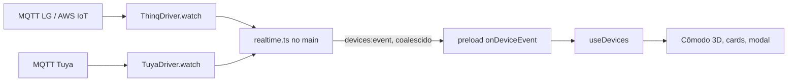

# Estado em tempo real: MQTT da LG e da Tuya

Status: planejado em 15/10/2026. Nada implementado ainda.

Hoje o app só fica sabendo do estado de um aparelho quando pergunta à nuvem (`refresh` e `refreshIfStale` em `useDevices`, e o `getDevice` 900 ms depois de cada comando). Uma mudança feita pelo controle remoto do ar ou pelo app do celular só aparece na maquete na próxima leitura. As duas integrações oferecem um canal MQTT oficial que avisa cada mudança assim que ela acontece. Este plano liga esses canais ao app.

## Por que agora

- A maquete 3D passa a refletir a casa de verdade, inclusive mudanças feitas fora do app.
- Destrava os **gatilhos por estado** da Etapa 3 do [plano da casa](PLANO-EXPERIENCIA-CASA.md), que dependem de "atualizações confiáveis".
- Poupa a cota da API da LG (erro 1306): os eventos chegam pelo MQTT e não contam como chamadas REST.
- Entrada e saída de aparelhos da conta passam a chegar como evento, e não mais só na próxima leitura.

## O que cada nuvem oferece

Conferido no código dos SDKs oficiais (`thinqconnect`, Apache-2.0, e `tuya-device-sharing-sdk` 0.2.15, MIT). A documentação pública não cobre esses detalhes.

### LG ThinQ Connect: AWS IoT com certificado do cliente

1. `POST client` com `{"type":"MQTT","service-code":"SVC202","device-type":"607","allowExist":true}` registra o nosso `x-client-id` (o mesmo `getClientId()` usado no REST). `allowExist` faz a chamada poder ser repetida sem erro.
2. `GET route` devolve `mqttServer` (`mqtts://<host>:<porta>`).
3. O app gera uma chave RSA 2048 e um CSR com `CN=lg_thinq`. `POST client/certificate` com `{"service-code":"SVC202","csr":"<PEM sem cabeçalho e rodapé>"}` devolve `certificatePem` e `subscriptions[0]`, que é o tópico a assinar.
4. Conexão MQTT com TLS mútuo (chave + certificado), `clientId` igual ao `x-client-id`, QoS 1, sessão persistente. A CA é a Amazon Root CA 1, que já vem na lista de raízes do Node; não precisa baixar nem empacotar.
5. Por aparelho, `POST event/{deviceId}/subscribe` (expira em 4464 h; o Home Assistant renova uma vez por dia). `POST push/devices` assina as entradas e saídas de aparelhos na conta.
6. As mensagens são JSON com `deviceId`, `deviceType`, `pushType` e `report`. `pushType: "DEVICE_STATUS"` traz em `report` um **estado parcial no mesmo formato do `GET state`** (por exemplo, só `{"airConJobMode": {...}}`). `"DEVICE_PUSH"` traz `pushCode` (avisos como filtro; fica para depois).

### Tuya (conexão por QR Code): MQTT com usuário e senha

1. `POST /v1.0/m/life/ha/access/config` com `{"linkId":"home-control.<uuid>"}`, pela mesma sessão assinada que o `TuyaSharing` já usa. Devolve `url` (`ssl://host:porta`), `clientId`, `username`, `password`, `expireTime` e os modelos de tópico `topic.ownerId.sub` e `topic.devId.sub`.
2. A conexão assina um tópico por casa (`ownerId`) e um por aparelho: `devId.sub` + `/pen` quando o aparelho tem `support_local`, ou `/sta` quando não tem.
3. As credenciais expiram: o SDK busca a configuração de novo e reconecta a cada `expireTime − 60 s`. Se a conexão for recusada por autorização (código 5), busca a configuração na hora.
4. As mensagens são JSON sem criptografia:
   - `protocol: 4` traz o estado: `data.devId` e `data.status[]`. Os itens vêm como `{code, value}` ou, nos aparelhos com `support_local`, como `{dpId, value}`. Para esse segundo formato é preciso traduzir o `dpId` com o `local_strategy` do aparelho (`status_code` e `value_convert`), que vem na listagem de aparelhos. **Hoje `devicesFrom` descarta esses campos.**
   - `protocol: 20` traz `bizCode` igual a `online`, `offline`, `nameUpdate`, `delete` ou `bindUser`, com `bizData.devId`.

**Conexão por projeto cloud (Access ID/Secret):** o tempo real desse modo usa outro serviço (Pulsar), que exige configurar o projeto no portal. Fica fora deste plano; esse modo continua com a atualização como hoje e é identificado assim na interface.

## Arquitetura

O princípio de sempre continua valendo: **a UI nunca fala LG nem Tuya.** O MQTT mora no processo principal, dentro de cada driver. O renderer só recebe `Device` já traduzido, nunca o payload bruto.



### Contrato novo (opcional no `Driver`)

```ts
// shared/types.ts
export type DeviceEvent =
  | { type: 'state'; device: Device }                    // estado completo, já traduzido pelo driver
  | { type: 'availability'; deviceId: string; online: boolean }
  | { type: 'inventory' }                                // aparelho entrou, saiu ou mudou de nome: reler a lista

export type RealtimeState = 'off' | 'connecting' | 'live' | 'unavailable'

// DriverStatus ganha:
realtime?: { state: RealtimeState; error?: string }

// main/drivers/types.ts
export interface RealtimeHandle { stop(): Promise<void> }
export interface Driver {
  // ...o que já existe
  /** Ausente = integração sem tempo real; o app segue atualizando como hoje. */
  watch?(emit: (event: DeviceEvent) => void, status: (state: RealtimeState, error?: string) => void): Promise<RealtimeHandle>
}
```

O transporte MQTT entra por injeção (uma fábrica `connect(options) → cliente`), para os testes rodarem com um broker falso, no mesmo estilo dos `cloudFixture` atuais.

### Arquivos

| Área | Arquivo | Mudança |
| --- | --- | --- |
| Contrato | `shared/types.ts`, `main/drivers/types.ts` | `DeviceEvent`, `RealtimeState` e `watch?` |
| Orquestração | `main/realtime.ts` (novo) | Liga e desliga o `watch` de cada driver; agrupa eventos por aparelho (~100 ms); envia `devices:event` e `realtime:status` às janelas |
| Ciclo de vida | `main/drivers/registry.ts`, `main/index.ts`, `main/ipc.ts` | `invalidateDrivers()` para o tempo real antigo e sobe o novo; parar em `before-quit` |
| LG | `main/drivers/thinq/client.ts` | `registerClient`, `getRoute`, `issueCertificate`, `subscribeEvents`, `subscribeDevices` |
| LG | `main/drivers/thinq/csr.ts` (novo) | Chave RSA 2048 + CSR PKCS#10 (ver decisões) |
| LG | `main/drivers/thinq/realtime.ts` (novo) | Conexão mTLS, renovação diária das assinaturas, aplicação do `report` parcial |
| LG | `main/drivers/thinq/driver.ts` | Guardar o último estado bruto por aparelho; `applyReport(raw, report)` → `readState` |
| Tuya | `main/drivers/tuya/sharing.ts` | `getMqttConfig()`; `devicesFrom` passa a manter `support_local` e um `local_strategy` reduzido (`dpId → status_code, value_convert`), **nunca o `local_key`** |
| Tuya | `main/drivers/tuya/realtime.ts` (novo) | Conexão, tópicos por casa e por aparelho, reconexão por `expireTime`, protocolos 4 e 20 |
| Tuya | `main/drivers/tuya/driver.ts` | Guardar o último `status` por aparelho e reconstruir o `Device` com `readState` |
| Cofre | `main/store.ts` | Chave e certificado MQTT da LG cifrados com `safeStorage`, ligados ao `clientId` |
| Ponte | `preload/index.ts` | `onDeviceEvent(cb) → unsubscribe` e `onRealtimeStatus(cb)` |
| UI | `hooks/useDevices.ts` | `applyDeviceEvent` (função pura, testável) e proteção contra leitura antiga |
| UI | `Sidebar.tsx` ou cabeçalho do cômodo | Indicador discreto: "Ao vivo" ou "Atualização manual" |

### Regras de estado no renderer

- **`state`**: troca o aparelho pela chave composta. Chave desconhecida dispara `refresh(driverId)` em vez de inventar um aparelho.
- **Comando em voo** (`pending` tem a chave): ignora eventos daquele aparelho até a resposta do comando chegar. Mensagens intermediárias (por exemplo, a energia antes da temperatura) fariam o controle piscar. Se alguma mudança real se perder nessa janela de ~1 s, o próximo evento corrige.
- **Leitura antiga**: guardar `lastEventAt` por aparelho. Uma resposta de `listDevices` que **começou** antes do último evento daquele aparelho não sobrescreve esse aparelho. Hoje a proteção existe só entre um refresh e outro.
- **`availability`**: muda só `online`.
- **`inventory`**: `refresh(driverId)` com limite de frequência; o `placeDevices` continua levando aparelhos novos ao cômodo base, como hoje.

### Falhas e reconexão

- O tempo real é um **extra**: se não conectar, o app funciona exatamente como hoje e o indicador mostra "Atualização manual". Nunca derruba a lista nem a outra integração.
- Reconexão com espera crescente (1 s → 60 s, com variação aleatória). Ao voltar de suspensão (`powerMonitor` `resume`) ou ao reconectar, fazer **um** `refresh` daquele driver, porque eventos podem ter se perdido.
- LG: se a conexão for recusada pelo certificado, apagar chave e certificado salvos e emitir de novo, **uma vez**. Se falhar de novo, o estado vira `unavailable` com a mensagem.
- Tuya: a sessão vencida ou removida (1010/1011/1012/1106) já tem mensagem própria; o tempo real só repassa o mesmo erro.

### Segurança

- Payload MQTT é dado não confiável: limitar o tamanho (~64 KB), validar a forma com o mesmo rigor de `devicesFrom` e aceitar só aparelhos conhecidos e campos usados.
- TLS sempre verificado. Validar o host recebido: o `mqttServer` da LG deve terminar em `.amazonaws.com`; a `url` da Tuya deve ser `ssl:` num domínio oficial (conferir os hosts reais na etapa 0 antes de fixar a lista, no mesmo estilo de `OFFICIAL_ENDPOINTS`).
- Chave privada, certificado, usuário e senha do MQTT nunca vão para o renderer, para logs nem para o `config.json` em texto puro.

## Decisões

1. **Biblioteca MQTT: `mqtt` (MQTT.js v5).** Escrever o protocolo à mão não compensa. Ela roda no processo principal e atende os dois casos (TLS mútuo e usuário/senha). É a primeira dependência nova de rede do app.
2. **CSR da LG: implementação própria pequena** (`csr.ts`, uns 80 linhas de ASN.1/DER, só com `CN`), no mesmo espírito da implementação nativa do protocolo Tuya. O `node:crypto` gera a chave e assina, mas não monta CSR. A alternativa é `@peculiar/x509`, se preferir não manter DER na mão.
3. **Guardar chave e certificado da LG** no cofre, para não emitir um certificado a cada abertura do app. Não apagar o registro do cliente ao fechar: o `allowExist` torna o registro repetível, e o Home Assistant só apaga ao desinstalar a integração. Apagar fica para quando o token LG for removido nas Preferências.
4. **Tuya antes da LG.** É mais simples (sem certificado) e valida o encanamento inteiro (driver → main → IPC → `useDevices` → maquete) com risco menor.

## Etapas

### Etapa 0: reconhecimento com as contas reais (curta)

Modo de diagnóstico só em desenvolvimento (variável de ambiente), que conecta os dois MQTTs com as credenciais já salvas e grava as mensagens **sanitizadas** (sem IDs reais, nomes, tokens ou chaves) em `userData/realtime-capture-<data>.jsonl`. Roda sem janela e recusa rodar com o app aberto. Com `HOME_CONTROL_REALTIME_PROBE=1`, provoca mensagens: muda o brilho das lâmpadas acesas e volta, **acende por alguns segundos as apagadas** e, só se o ar já estiver ligado, sobe 1 °C e volta. Com o ar e as duas lâmpadas, mudar o estado pelo controle remoto e pelo app do celular. Respostas esperadas:

- Host real do `mqttServer` da LG, porta e ALPN; se o certificado é aceito; código de erro de "já assinado".
- Forma exata do `report` do **nosso** modelo de ar (parcial ou completo, temperatura em `temperatureInUnits` ou em `temperature`).
- Se as lâmpadas mandam `code` ou `dpId` e, no caso de `dpId`, quais `value_convert` aparecem e em que formato chega `colour_data_v2` (JSON `{h,s,v}` ou texto hexadecimal).
- Host e porta reais do MQTT Tuya.

**Resultado da captura (15/10/2026)**, com `HOME_CONTROL_REALTIME_CAPTURE=1` (`src/main/realtime/capture.ts`):

- LG funcionou de ponta a ponta: `POST client` → `GET route` → CSR → `POST client/certificate` → conexão mTLS aceita.
- `route` devolve `mqttServer: mqtts://<id>-ats.iot.us-west-2.amazonaws.com:8883` (e um `webSocketServer` wss:443, não usado). O sufixo `.amazonaws.com` se confirma.
- O certificado vem **dentro de `result`**: `{resultCode, result: {certificatePem, subscriptions, publications}}`. `subscriptions` traz **dois** tópicos: `app/clients/<clientId>/push` e `app/clients/<clientId>/inbox`; assinamos os dois.
- `event/{id}/subscribe` e `push/devices` responderam sem erro.
- O ar estava desligado, então a sonda não mexeu nele e nenhuma mensagem de estado chegou. O formato do `report` segue o do SDK (estado parcial) e será conferido no aparelho real; enquanto isso, o código cai numa releitura REST se não conseguir aplicar.
- **A Tuya não está conectada nesta máquina** (só há token LG no `config.json`). O MQTT Tuya é implementado conforme o SDK; a verificação real fica para quando a conta for conectada pelo QR Code.

As capturas viram fixtures dos testes. Se `dpId` vier com conversões que não dominarmos, a saída é tratar a mensagem como **aviso** e reler só aquele aparelho por REST, com limite de frequência.

### Etapa 1: encanamento comum

`DeviceEvent`, `watch?`, `main/realtime.ts`, IPC, preload, `applyDeviceEvent` em `useDevices` e indicador na UI, testados com um driver falso que emite eventos.

**Pronto quando** um driver falso muda uma lâmpada na maquete sem nenhum `listDevices`, comandos em voo não piscam e leituras antigas não sobrescrevem eventos novos.

### Etapa 2: Tuya ao vivo

`getMqttConfig`, campos locais em `devicesFrom`, `tuya/realtime.ts`, reconexão por `expireTime` e protocolos 4 e 20.

**Pronto quando** ligar uma lâmpada pelo app Smart Life acende a lâmpada na maquete em até ~2 s; tirar da tomada a mostra offline; e renomear ou remover no app atualiza a lista.

### Etapa 3: LG ao vivo

Endpoints novos no `ThinqClient`, `csr.ts`, certificado no cofre, assinaturas por aparelho e de `push/devices` com renovação diária, e `report` parcial aplicado sobre o último estado.

**Pronto quando** mudar temperatura, modo ou energia pelo controle remoto do ar aparece no mostrador em até ~2 s, e fechar e reabrir o app reconecta sem emitir outro certificado.

### Etapa 4: colher os ganhos

- Com tempo real ativo, o `executeCommand` deixa de esperar 900 ms fixos e passa a confirmar pelo evento, com `getDevice` só se nada chegar em ~3 s.
- O `getDevice` da LG deixa de chamar `listDevices` inteiro (usa o cache de aparelhos).
- `DEVICE_PUSH` (avisos, como troca de filtro) fica disponível para notificações futuras.

## Verificação

- **Testes (`node:test`):** CSR (estrutura DER e assinatura conferida com `node:crypto`); `applyReport` da LG com fixtures; protocolos 4 e 20 da Tuya, incluindo `dpId`; reconexão e renovação com relógio e broker falsos; `applyDeviceEvent` com comando em voo e leitura antiga; parada limpa ao trocar credenciais.
- **Regressão:** a suíte atual de LG, Tuya e layout continua passando; sem tempo real, o comportamento é idêntico ao de hoje.
- **Hardware real:** controle remoto e app do celular refletidos na maquete; queda de Wi-Fi; suspender e acordar o PC; trocar token LG e reconectar a Tuya com o app aberto; deixar o app aberto por mais de 2 h (renovação da Tuya) e por mais de 1 dia (renovação da LG).

## Fora deste plano

- Tempo real no modo Tuya por projeto cloud (Pulsar).
- Notificações do sistema operacional a partir de `DEVICE_PUSH`.
- Manter a conexão com a janela fechada (bandeja), que continua sendo decisão da Etapa 3 do plano da casa.
